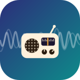
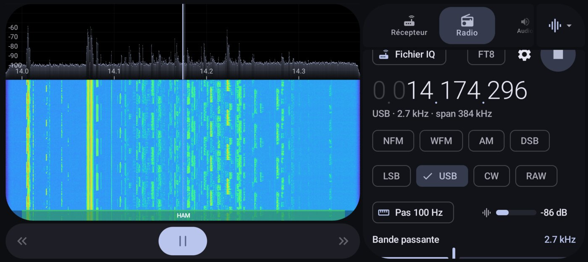
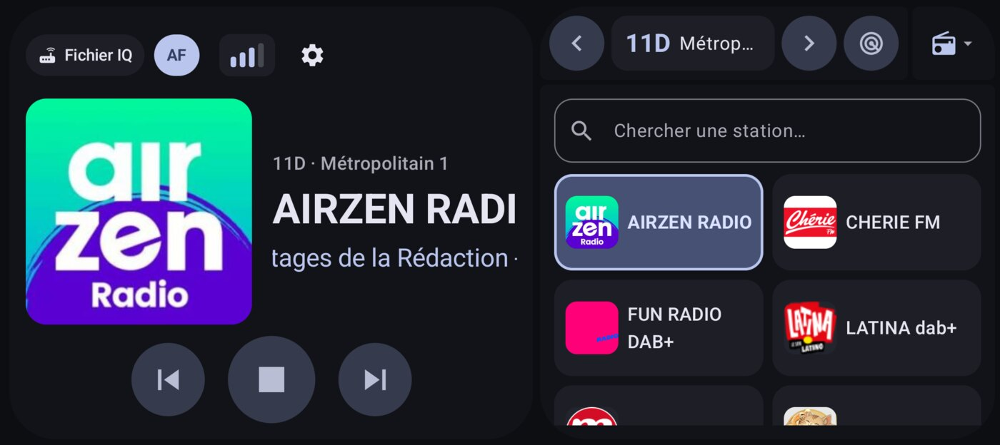
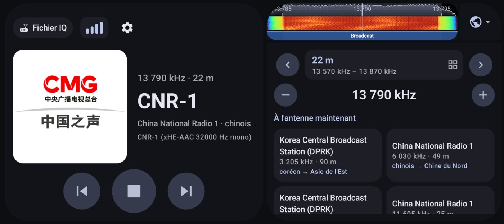
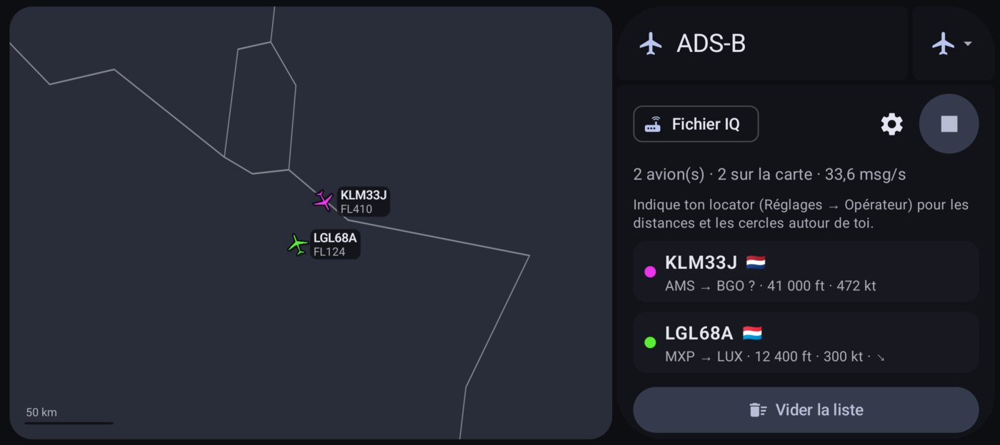
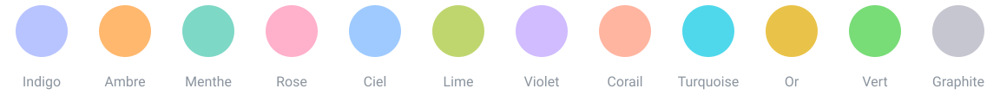
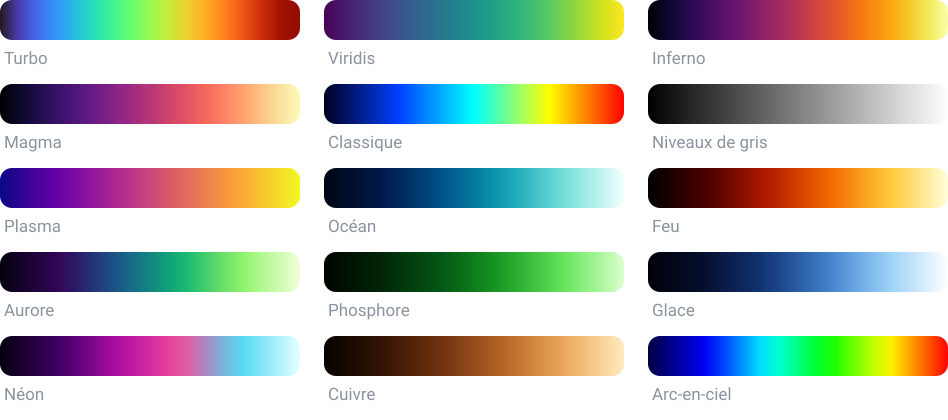

<div align="center">



# LittleSDR

**Un récepteur SDR pour Android, pensé pour le tactile, avec son propre moteur radio en Rust.**<br>
SDR, radio numérique DAB+ et DRM, avions en ADS-B, images satellite Meteor : une seule app, une interface par usage.

[](../../releases/latest)
[](../../releases)




</div>

---

LittleSDR est une app Android de réception radio logicielle. Tout le traitement du signal, les décodeurs, la sortie son et l'affichage du spectre viennent d'un **moteur écrit en Rust** (`engine/`), sans C++ ; l'interface est en Kotlin / Jetpack Compose Material 3.

## ✨ Une interface par usage

Un bouton, toujours en haut à droite, change d'interface et de récepteur.

### 📈 SDR : l'écran complet

- Démodulation NFM, WFM (stéréo, RDS), AM, DSB, USB, LSB, CW, IQ brut ; NB, réduction de bruit (NR) et notch automatique
- Spectre et waterfall en **Vulkan**, lissés quand on dézoome, **15 palettes** ; zoom au doigt, joystick d'accord
- Plan de bandes coloré selon la région UIT, préréglages (FM, LW, MW, HF, CB, VHF, UHF, PMR446), mémoires
- Horaires ondes courtes **EiBi**, RDS en FM
- **FT8 / FT4** (liste et carte des liaisons), **morse** (tous les signaux CW d'une bande), **SSTV** (ISS…)
- **Enregistrement** du son ou de l'IQ (bande entière, autour de la fréquence, ou largeur au choix), relecture des fichiers IQ

<table>
<tr>
<td width="50%" valign="top">

### 📻 DAB+ : un autoradio



- Grand afficheur : logo ou diaporama de la station, nom, texte défilant, barres de signal
- Boutons ⏮ ▶ ⏭, stations en tuiles, **recherche par nom** dans tous les multiplex entendus
- Recherche automatique des multiplex (bande III, 5A à 13F)
- **Suivi de station (AF)** en déplacement, puis **repli FM** si la station quitte le DAB
- Logos des stations (annuaire radio-browser.info, Wi-Fi seulement par défaut)

</td>
<td width="50%" valign="top">

### 🌍 DRM : la radio numérique en ondes courtes



- Son **AAC, HE-AAC et xHE-AAC** : RRI, CNR et la plupart des radios DRM
- Pertes masquées comme en DAB+ (dernière trame rejouée en fondu)
- La **grille officielle des émissions** (drm.org), mise à jour chaque semaine : « À l'antenne maintenant », « Plus tard »
- Stations reçues retenues, spectre de la bande, accord au pas de 5 kHz

</td>
</tr>
<tr>
<td width="50%" valign="top">

### ✈️ ADS-B : les avions autour de toi



- Les avions (1090 MHz) sur une carte, trace colorée selon l'altitude, cercles de distance depuis ton locator
- Vol, départ et arrivée, compagnie, appareil et sa photo
- Altitude, vitesse, cap, vario, transpondeur et urgences

</td>
<td width="50%" valign="top">

### 🧭 VOR : les balises de radionavigation

- Le radial sur lequel tu te trouves (108 – 117,95 MHz), sur une rose des vents, et le cap vers la balise
- L'indicatif en morse décodé, la balise reconnue parmi les 3 600 VOR du monde (OurAirports), sa distance
- Les balises les plus proches de ton locator, à toucher pour s'y accorder

### 🛰️ LRPT : les satellites météo

- Images des satellites **Meteor-M** (137 MHz), affichées ligne par ligne pendant le passage
- QPSK et OQPSK, image enregistrée en PNG

### 🎨 À tes couleurs

- **12 couleurs d'accent**, ou celles de ton fond d'écran (Material You)
- Thème sombre, clair ou celui du système
- Portrait et paysage partout (support de voiture)



</td>
</tr>
</table>

### 🌈 Palettes du waterfall



## 📡 Récepteurs

| Liaison | Récepteurs |
|---|---|
| USB (OTG) | RTL-SDR (dont Blog V4, bias-tee), Airspy R2 / Mini, Airspy HF+, HackRF One (préampli, alimentation d'antenne) |
| USB, Linux | SDRplay RSP1, RSP1A / 1B, RSP2, RSPduo, RSPdx (avec l'API SDRplay 3 installée et son service lancé) |
| Réseau | rtl_tcp, SpyServer, serveur SDR++ (`sdrpp --server` : le récepteur d'un autre ordinateur, quel qu'il soit), KiwiSDR (annuaire public, serveurs qui refusent les applications signalés) |
| SoapySDR, Linux | LimeSDR, bladeRF, USRP, PlutoSDR, RX888, Red Pitaya… : tout appareil qui a son module SoapySDR (SoapySDR installé, chargé à l'ouverture) |
| Fichier | enregistrements IQ en WAV |

## 📥 Installation

Télécharge le dernier APK dans les [**Releases**](../../releases) et installe-le. Branche ton récepteur en OTG : l'app propose de s'ouvrir et sélectionne la source toute seule.

> Les versions jusqu'à la 1.2.0 étaient signées avec une clé de développement. Pour passer à une version signée avec la clé de publication, désinstalle une fois l'ancienne (les réglages sont perdus).

## 🛠️ Compiler

Prérequis :
- SDK Android avec le NDK `29.0.14206865`, un JDK 21
- Rust (`rustup`) avec les cibles Android et `cargo-ndk` :
  ```sh
  rustup target add aarch64-linux-android x86_64-linux-android
  cargo install cargo-ndk
  ```
- `cmake`, `ninja`, `git`, `curl`

```sh
git clone https://github.com/Radinux/LittleSDR.git
cd LittleSDR
kit/build-kit.sh                        # une fois : pilotes RTL-SDR et Airspy (librtlsdr, libusb, libairspy, libairspyhf)
engine/scripts/build-android-aac.sh     # une fois : décodeurs AAC (FAAD2 pour le DAB+, libxaac pour le DRM)
./gradlew assembleRelease               # app/build/outputs/apk/release/app-release.apk
```

Gradle compile le moteur Rust avec `cargo ndk`. Sans les décodeurs AAC, l'app se construit quand même mais le son DAB+ / DRM reste muet. Sans clé de publication (voir `app/build.gradle.kts`), l'APK est signé avec la clé de débogage.

Le moteur se compile et se teste aussi sur Linux, avec un outil en ligne de commande :

```sh
cd engine
cargo test --release
cargo run --release -- --help
```

## 🐧 Prototype Linux

Le même moteur sur le bureau, avec une interface egui : spectre et cascade (clic pour accorder), modes, réglages du récepteur, stations DAB+, RDS, DRM. Son par PipeWire / ALSA.

```sh
cd desktop
cargo run --release                                   # source et fréquence gardées d'une fois sur l'autre
cargo run --release -- --file capture.wav --mode 8    # un enregistrement IQ, en DAB+
```

Options : `--file <iq.wav>`, `--mode <0-10>` (NFM, WFM, AM, DSB, USB, CW, LSB, RAW, DAB+, DRM, LRPT), `--no-audio`. Les réglages vont dans `~/.local/share/littlesdr`. Il faut `libfaad` (paquet `faad2`) et, pour le RTL-SDR en USB, `librtlsdr`.

## 🧩 Architecture

```
Kotlin / Compose Material 3              app/src/main/java/app/littlesdr
 ├─ ui/        écrans (SDR, autoradio DAB+, DRM, LRPT, ADS-B), réglages, cartes FT8 et ADS-B
 ├─ engine/    façade vers le moteur (JNI), modèles
 ├─ data/      mémoires, préférences, EiBi, logos, position
 ├─ usb/       détection, permission, descripteur USB → pilote
 └─ service/   service au premier plan (écoute en arrière-plan)

Rust                                     engine/   (desktop/ : prototype Linux, egui)
 ├─ src/service/   couche pour l'app : sources, fil DSP, spectre, état, réglages
 ├─ src/android/   JNI, son AAudio, rendu Vulkan (ash), shaders GLSL
 ├─ src/source/    RTL-SDR, rtl_tcp, SpyServer, KiwiSDR, fichiers WAV
 ├─ src/dab/, drm/, lrpt/, ft8/, cw.rs, sstv.rs, rds.rs, recorder.rs …
 └─ scripts/build-android-aac.sh
```

## 🙏 Crédits

- [SDR++](https://github.com/AlexandreRouma/SDRPlusPlus) et [SDR++Brown](https://github.com/sannysanoff/SDRPlusPlusBrown) : premier moteur de l'app, base de données CTY des indicatifs
- [Dream](https://sourceforge.net/projects/drm/) et [gr-drm](https://github.com/kit-cel/gr-drm) : références pour le décodeur DRM
- [FAAD2](https://github.com/knik0/faad2) (AAC, HE-AAC) et [libxaac](https://github.com/ittiam-systems/libxaac) (xHE-AAC)
- [librtlsdr](https://github.com/osmocom/rtl-sdr), [libhackrf](https://github.com/greatscottgadgets/hackrf) (fork Android de SDR++), [libairspy](https://github.com/airspy/airspyone_host), [libairspyhf](https://github.com/airspy/airspyhf) et [libusb](https://libusb.info/)
- API SDRplay 3 : propriétaire, non fournie ; chargée seulement si elle est installée
- [radio-browser.info](https://www.radio-browser.info/) : logos des stations
- [adsbdb.com](https://www.adsbdb.com/) : routes des vols et fiches des avions (ADS-B)
- [KiwiSDR](http://kiwisdr.com/public/) : annuaire public des récepteurs (via rx.linkfanel.net)
- [EiBi](http://www.eibispace.de/) : horaires des stations ondes courtes (usage non commercial)
- [Natural Earth](https://www.naturalearthdata.com/) : fond de carte (domaine public)
- [OurAirports](https://ourairports.com/data/) : liste des balises VOR (domaine public)
- Palettes Viridis, Inferno, Magma : approximations polynomiales de Matt Zucker ; Turbo : Google ; Plasma : d'après matplotlib
- [drm.org](https://www.drm.org/) : grille des émissions DRM

## 📄 Licence

LittleSDR (app et moteur) est distribué sous **GPL-3.0-or-later**. Les bibliothèques liées gardent leur licence : FAAD2 (GPL-2.0-or-later), libxaac (Apache-2.0), librtlsdr (GPL-2.0-or-later), libhackrf (BSD-3-Clause), libusb (LGPL-2.1), libairspy (BSD), libairspyhf (BSD-3-Clause, ou GPL-2.0 au choix). L'API SDRplay, propriétaire, n'est ni liée ni distribuée : LittleSDR la charge à l'exécution si l'utilisateur l'a installée.
