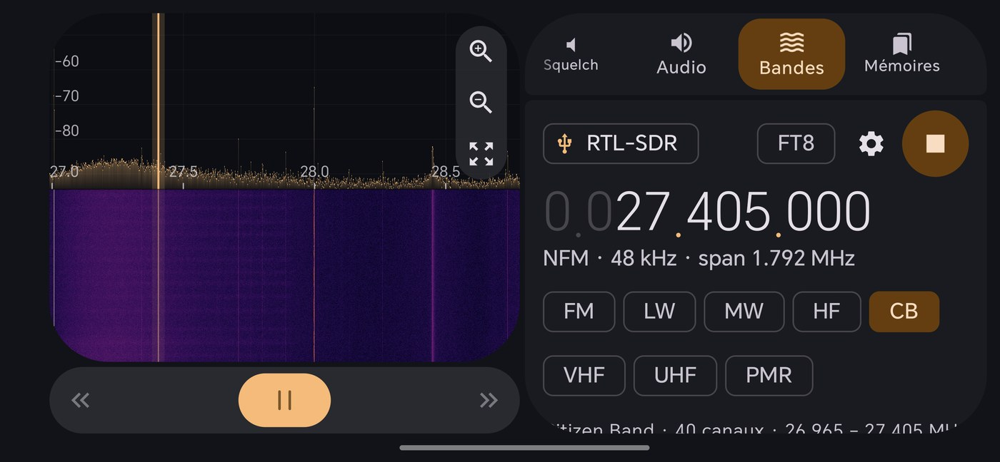

<div align="center">

# 📻 LittleSDR

**Un récepteur SDR pour Android, pensé pour le tactile.**
Interface Jetpack Compose Material 3, waterfall en Vulkan, moteur radio SDR++Brown.




</div>

---

LittleSDR est une **refonte de l'interface**, pas un fork : le traitement du signal et les pilotes viennent tels quels de [SDR++Brown](https://github.com/sannysanoff/SDRPlusPlusBrown) (lui-même basé sur [SDR++](https://github.com/AlexandreRouma/SDRPlusPlus)), intégré comme sous-module **sans aucune modification**. Tout ce qui se voit et se touche est neuf.

## ✨ Fonctionnalités

**Réception**
- Démodulation NFM, WFM (stéréo, RDS), AM, DSB, USB, LSB, CW
- Bande passante au pas de 1 kHz, ou **automatique en FM** (mesurée sur le signal)
- Gain RF du récepteur, AGC, squelch, noise blanker, réduction de bruit FM, désaccentuation
- **Préréglages de bandes** : FM, LW, MW, HF, CB (40 canaux), VHF, UHF, PMR446 (16 canaux)
- Fréquences mémorisées

**Affichage**
- Spectre et waterfall rendus en **Vulkan**, six palettes (Turbo, Viridis, Inferno, Magma…)
- **Joystick d'accord** : plus on l'écarte, plus le VFO défile vite
- Zoom (boutons, double tap, pincement), le VFO reste toujours visible
- **Encoche** en haut du spectre : RDS en FM, horaires ondes courtes **EiBi** ailleurs
- **Plan de bandes** coloré sous le waterfall (radioamateur, radiodiffusion, CB, aviation, marine) selon la région UIT

**Décodage**
- **FT8 / FT4** : liste groupée par cycle et **carte** des stations avec les liaisons émetteur → destinataire
- Locator automatique d'après la position du téléphone

**Interface**
- Paysage, panneau à onglets défilants (Récepteur, Radio, Audio, Bandes, Mémoires)
- Material You (couleurs du fond d'écran) ou couleur d'accent au choix, thème sombre ou clair
- Écoute écran éteint, écran maintenu allumé pendant la réception

## 📡 Récepteurs pris en charge

| Liaison | Récepteurs |
|---|---|
| USB (OTG) | RTL-SDR, Airspy, Airspy HF+, HackRF |
| Réseau | rtl_tcp, SpyServer (`sdr://hôte:port`, débit adapté automatiquement), KiwiSDR* |

<sub>* sélection du serveur KiwiSDR pas encore disponible.</sub>

## 📥 Installation

Télécharge le dernier APK dans les [**Releases**](../../releases) et installe-le. Branche ton récepteur en OTG : l'app propose de s'ouvrir et sélectionne la bonne source toute seule.

## 🛠️ Compiler

Prérequis : SDK Android avec le NDK `29.0.14206865` et CMake `4.1.2` (via `sdkmanager`), un JDK 21 (Gradle le cherche dans `~/.jdks`).

```sh
git clone --recurse-submodules https://github.com/Radinux/LittleSDR.git
cd LittleSDR
kit/build-kit.sh            # une fois : dépendances natives (libusb, volk, fftw, zstd, pilotes)
./gradlew assembleRelease   # app/build/outputs/apk/release/app-release.apk
```

Le projet s'ouvre aussi directement dans Android Studio.

## 🧩 Architecture

```
Kotlin / Compose Material 3              app/src/main/java/app/littlesdr
 ├─ ui/        écrans, panneau à onglets, joystick, carte FT8, réglages
 ├─ engine/    Engine (façade unique vers le moteur), JNI, modèles
 ├─ data/      mémoires, préférences, EiBi, position
 ├─ usb/       détection, permission, descripteur USB → pilotes
 └─ service/   service au premier plan (écoute en arrière-plan)

C++ (NDK)                                app/src/main/cpp
 ├─ engine.cpp           moteur SDR++Brown sans interface
 ├─ headless_backend     API backend de SDR++ sans NativeActivity
 ├─ smgui_json.cpp       menus des pilotes → widgets Compose
 ├─ spectrum_renderer    Vulkan : spectre + waterfall
 └─ modules/             sortie AAudio, extensions radio et FT8

third_party/sdrpp-brown                  moteur SDR++Brown (sous-module, non modifié)
kit/build-kit.sh                         dépendances natives, sans Docker
```

L'interface ne parle au moteur qu'à travers `Engine` (état et JSON), pour pouvoir un jour le remplacer par un moteur en Kotlin pur.

## 🙏 Crédits

- [SDR++Brown](https://github.com/sannysanoff/SDRPlusPlusBrown) et [SDR++](https://github.com/AlexandreRouma/SDRPlusPlus) : traitement du signal, pilotes, décodeurs
- [EiBi](http://www.eibispace.de/) : horaires des stations ondes courtes (usage non commercial)
- [Natural Earth](https://www.naturalearthdata.com/) : fond de carte (domaine public)
- Palettes Viridis, Inferno, Magma : approximations polynomiales de Matt Zucker ; Turbo : Google

## 📄 Licence

LittleSDR se lie au moteur SDR++Brown, sous **GPL-3.0** ; l'ensemble est distribué sous la même licence.
